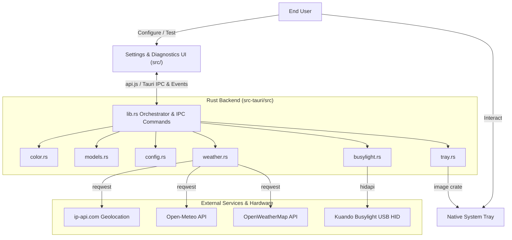

# Architecture Documentation

## Overview
**WeatherLight** is a native ambient weather visualization tool that interfaces with a **Kuando Busylight**. Rewritten from Electron to **Tauri v2**, it significantly reduces memory footprint and bundle size (~67MB down to ~6MB) while running silently in the Windows system tray, fetching local weather data, and translating temperature and precipitation into continuous light patterns and a dynamic tray icon.

## System Design

The Rust backend follows a **Shared State Concurrency** pattern built around `Arc<AppState>` (owned by Tauri's managed state) and dedicated background threads for weather polling and ~30 FPS HID animation.

## Module Breakdown

### Backend (`src-tauri/src/`)

1. **`lib.rs` (Application Orchestrator & IPC Bridge)**
   - **Lifecycle**: Configures Tauri plugins (`single-instance`, `autostart`, `opener`), intercepts `WindowEvent::CloseRequested` and `RunEvent::ExitRequested` so closing the Settings window hides to the system tray instead of quitting.
   - **Background Scheduler**: Spawns a Tokio task that runs `update_weather_pipeline` immediately at startup and every 15 minutes (`WEATHER_POLL_INTERVAL`), plus on demand when triggered by `"refresh_weather"` or `set_settings`.
   - **IPC Commands**: Exposes 12 `#[tauri::command]` handlers (`get_settings`, `set_settings`, `close_settings`, `detect_location`, `validate_location`, `get_weather_state`, `get_device_info`, `get_busylight_status`, `set_manual_mode`, `apply_manual_state`, `open_external`, `resize_settings`) and emits `"busylight-status"` events whenever hardware status is evaluated.
   - **Formatting & Control Helpers**: `format_tray_tooltip` (converts internal Celsius to `"C"` or `"F"`, normalizes `-0.0`, and appends `(Precip)` / `(Night)`) and `apply_lighting_target`.

2. **`color.rs` (Color Scale & Hex Parsing)**
   - Owns the canonical 121-stop `COLOR_SCALE` (`-50.0°C` to `+70.0°C`), `calculate_weather_color` (linear per-channel interpolation with `.round()` clamping), `hex_to_rgb`, and `hex_to_rgba`.
   - Shared single source of truth for both `BusylightController` lighting output and `tray.rs` icon rendering.

3. **`models.rs` (Shared IPC DTOs)**
   - Defines `SunTimes`, `WeatherState`, `ProviderFeedSnapshot`, `ForecastItem`, `LocationDetectResult`, `LocationValidationResult`, `DeviceInfoResult`, and `ManualState`.
   - Uses `#[serde(rename_all = "camelCase")]` on multi-word structs to align 1:1 with JavaScript property names.

4. **`config.rs` (Persistent Configuration)**
   - Manages `AppConfig` serialized to `<DATA_DIR>/WeatherLight/config.json` (`%APPDATA%\WeatherLight\config.json` on Windows) with `#[serde(rename_all = "camelCase", default)]`.
   - Provides `load_config`, `save_config`, `get_config_path`, `AppConfig::requires_api_key`, and `AppConfig::format_temperature`.

5. **`busylight.rs` (USB HID Driver & Smooth Pulse Engine)**
   - Drives Plenom/Kuando Omega/Alpha devices (`VID 0x27bb`, 65-byte report with 16-bit big-endian checksum) and legacy Microchip UC devices (`VID 0x04d8`, 9-byte report) directly over `hidapi`.
   - Enforces Kuando's `0..=100` hardware PWM duty-cycle ceiling (`MAX_HARDWARE_PWM = 100.0`, via `hardware_ceiling_for_color`) across `compute_pulse_power_bounds`, `light_pct`, and `degamma` so high-saturation temperatures (such as `40°C` `(255, 1, 1)` or `-19°C` `(25, 25, 140)`) never pin flat at 100% DC.
   - Spawns a dedicated `std::thread` polling `PulseState` at ~30 FPS (`compute_pulse_frame`), isolated from async weather requests.
   - Applies a `1.5` perceptual brightness exponent (`BRIGHTNESS_GAMMA`) with rounded scaling (`scale_color_with_power`) and low-PWM beat-flicker stabilization (`stabilize_pulse_channel` + `MIN_ACTIVE_CHANNEL_FLOOR = 13.0` / `MIN_SMOOTH_PULSE_PWM = 13` capped at `MAX_FLOOR_POWER_RATIO = 0.55`): active channels whose peak reaches `>= 13` are floored at `13` (staying clear of the `1..=12` 30 FPS beat-flicker zone), while tiny trace channels (`peak < 13`, such as `G=1, B=1` at `40°C`) are suppressed to `0` so they never strobe at ~10 Hz.
   - Emits active pulse frames at a steady 33ms USB HID cadence without skipping repeated turnaround frames (preventing transient `+35%` PWM-reset brightness pops at cycle troughs), while idle solid states send a 20-second keep-alive packet (`KEEPALIVE_INTERVAL`) for the hardware watchdog.

6. **`weather.rs` (Weather Providers, Smart Blend & Horizons)**
   - Wraps `reqwest::Client` (10-second timeout) for IP geolocation (`ip-api.com`), free-form location geocoding (Open-Meteo and OpenWeatherMap), and weather feeds (`"open-meteo"`, `"openweathermap"`, and `"both"`).
   - In `"both"` (Smart Blend) mode, fetches Open-Meteo and OpenWeatherMap concurrently (`tokio::join!`) with automatic failover to whichever provider responds; aligns OWM's live reading and 3-hour blocks onto Open-Meteo's hourly timeline via linear interpolation (`blend_weather_states`), blending current temperature (`55%` OWM live + `45%` OM), future temperatures (`50%/50%`), precipitation probability (`blend_precip_prob`, `60% max + 40% min + 5%` consensus bonus), and intensity (`blend_precip_rate`).
   - Parses upstream sunrise/sunset timestamps into UTC and determines `is_night` via `check_is_night_at` (handling both standard UTC ordering and wrapped UTC midnight intervals such as NZ/AU).
   - Evaluates configurable temperature high horizons (`current`, `short_high`, `today_high`, `day_high`) and precipitation horizons (`none`, `immediate`, `short`, `today`, `day` via `is_precip_triggered`), classifying intensity (`classify_precip_label`), populating `WeatherState::precip_summary` via `format_precip_alert`, and returning a 24h/48h `debug_forecast`.

7. **`tray.rs` (System Tray & Dynamic Swatch Icon)**
   - Builds the system tray menu (`Refresh`, `Settings`, `Start with Windows`, `Quit`) via Tauri's tray API. Note that `Quit` calls `std::process::exit(0)` to bypass exit prevention.
   - Syncs OS autostart changes back to `AppConfig` and `config.json`.
   - Generates a 16x16 RGBA swatch (`render_tray_icon_rgba`) with 2px rounded-corner transparency; when Night Mode is active, paints the upper half black with 5 white stars (`NIGHT_STAR_COORDS`).

### Frontend (`src/`)
- **`src/api.js`**: Clean JSDoc-documented `window.api` facade over Tauri's `invoke` and `listen`.
- **`src/settings.html` / `src/settings.js`**: Vanilla HTML/CSS/JS controller structured into 5 sections (DOM Registry, Auto-Resize/Hydration, Location/Settings Handlers, Hardware Status/External Links, Diagnostics Mode). Uses a single `ResizeObserver` so the native window dynamically matches content height, preserves background flags like `autoStart` when saving, and renders Diagnostics feed tabs (`Smart Blend`, `Open-Meteo`, `OpenWeatherMap`) whenever `weather.providerFeeds` has multiple snapshots.

## Data Flow

1. **Initialization**: `setup()` loads `AppConfig`, initializes `BusylightController` and `WeatherService`, reconciles OS autostart state, registers the tray icon, and starts the 15-minute scheduler.
2. **Weather Update (`update_weather_pipeline`)**:
   - Validates location/API key readiness (`WeatherLight - Setup Required` if incomplete).
   - Fetches normalized `WeatherState` from Open-Meteo, OpenWeatherMap, or both concurrently (`"both"` Smart Blend).
   - Formats display-unit tray tooltip (`°C`/`°F`) and regenerates the 16x16 tray icon.
   - Unless Diagnostics `manual_mode` is active, turns off the LED during night mode (`config.sunset_sunrise && weather.is_night`) or drives either `set_pulse` (when `weather.has_precipitation && config.pulse`) or `set_solid_pct`.
   - Emits `"busylight-status"` so any open Settings UI reflects current hardware connectivity.

## Build & Test Pipeline
- **Unit Tests**: Run `cargo test` inside `src-tauri/` to verify color interpolation, config serialization/conversion, pulse curves/bounds, weather horizons/night logic, tray RGBA rendering, and tooltip formatting without physical USB hardware.
- **Release Binary**: Run `npm run tauri build` (or `cargo build --release` in `src-tauri/`) with `Cargo.toml` LTO/size optimizations to produce the standalone portable Windows binary at `src-tauri/target/release/weatherlight.exe` (~6MB, relies on host WebView2).
